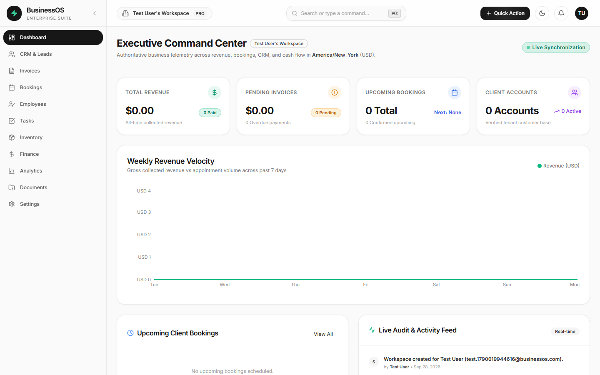

# BusinessOS

A full-stack project for managing CRM deals, itemized invoices, bookings and day-to-day company operations.

**Next.js 15 · TypeScript · Prisma · PostgreSQL / SQLite**

[Demo](https://business-os-manssouri.vercel.app) · [Portfolio case study](https://www.youssefmanssouri.site/projects/businessos) · [Engineering decisions](docs/CASE_STUDY.md)

The screenshot shows a test workspace. The local seed script provides synthetic records for exploring the workflows.

## What I built

- Customer records and a deal pipeline with table and Kanban views.
- Invoice creation, line-item calculations, payment states and printable layouts.
- Staff/service bookings with company timezone handling.
- Sessions, role guards and company-scoped data access.
- Supporting task, inventory, finance, employee and document-metadata modules.

## Start with the code

| Question | Where to inspect |
| --- | --- |
| How are companies and operational records related? | [Prisma schema](prisma/schema.prisma) |
| How are sessions and roles checked? | [Authentication and guards](src/lib/auth.ts) |
| Where do validation, ownership checks and writes happen? | [Server actions](src/lib/actions/index.ts) |
| How are invoice values preserved? | [Invoice verification suite](tests/verify-invoices.ts) |
| How are cross-company access rules exercised? | [Security verification suite](tests/verify-security.ts) |
| What runs the test suites? | [Test runner](scripts/run-all-tests.js) |

There are **14 verification suites** in [tests/](tests). That is a count of included suites, not a live pass result or a coverage percentage.

## Technical decisions

| Challenge | Decision | Trade-off |
| --- | --- | --- |
| Keep one company's records separate from another's | Derive company identity from the session and scope queries by company ID | Application code must apply the scope consistently; the guards and security tests are part of that discipline |
| Preserve issued invoice details after profiles or products change | Store party, tax, currency and item values on the invoice | Duplicate fields preserve history but require a deliberate edit policy |
| Make local setup inexpensive while supporting hosted relational storage | SQLite locally; PostgreSQL in hosted environments | The [provider-sync script](scripts/sync-database-provider.js) edits the schema provider; it does not migrate data between engines |

See [the engineering case study](docs/CASE_STUDY.md) for the request flow, implementation references and current limits.

## Run locally

Use Node.js 20+ and npm.

~~~sh
git clone https://github.com/youssefmanssouri/business-os.git
cd business-os
~~~

Create a root `.env` from [.env.example](.env.example). Keep the local database URL `file:./dev.db` and replace the session-secret placeholder with a random value of at least 32 characters.

~~~sh
npm install
npm run db:push
npm run db:seed
npm run dev
~~~

Open [localhost:3000](http://localhost:3000). The seed data is for local exploration; registration creates a new company workspace.

For PostgreSQL, set `DATABASE_URL` in the process/hosting environment before running the npm commands. The provider-sync script reads that process variable. Schema switching does not copy the local SQLite database into PostgreSQL.

## Verification commands

Use a disposable local database for the suites; they create and delete fixture records.

~~~sh
npm test
npm run lint
npm run build
~~~

The [runner](scripts/run-all-tests.js) executes each TypeScript suite and exits unsuccessfully if a suite fails. Inspect the current output when reviewing the project; no historical assertion count is presented as a current result here.

## More interface views

[CRM pipeline](screenshots/businessos/crm-pipeline.png) · [Invoices](screenshots/businessos/invoices.png) · [Bookings](screenshots/businessos/bookings.png) · [Finance](screenshots/businessos/finance.png)

Built by [Youssef Manssouri](https://www.youssefmanssouri.site) as an independent project.
